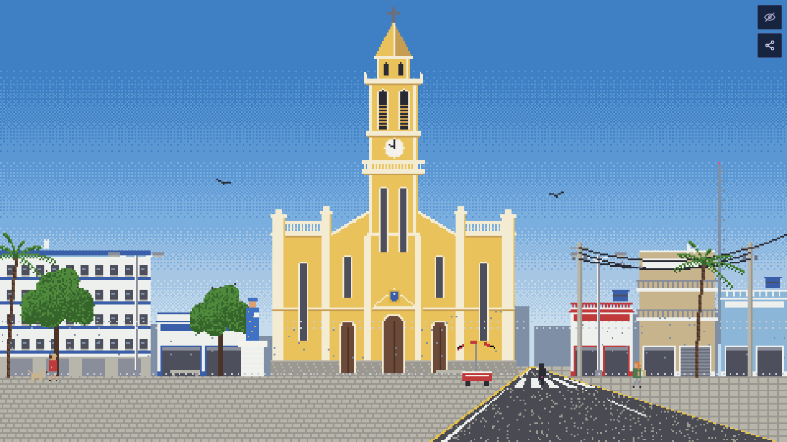
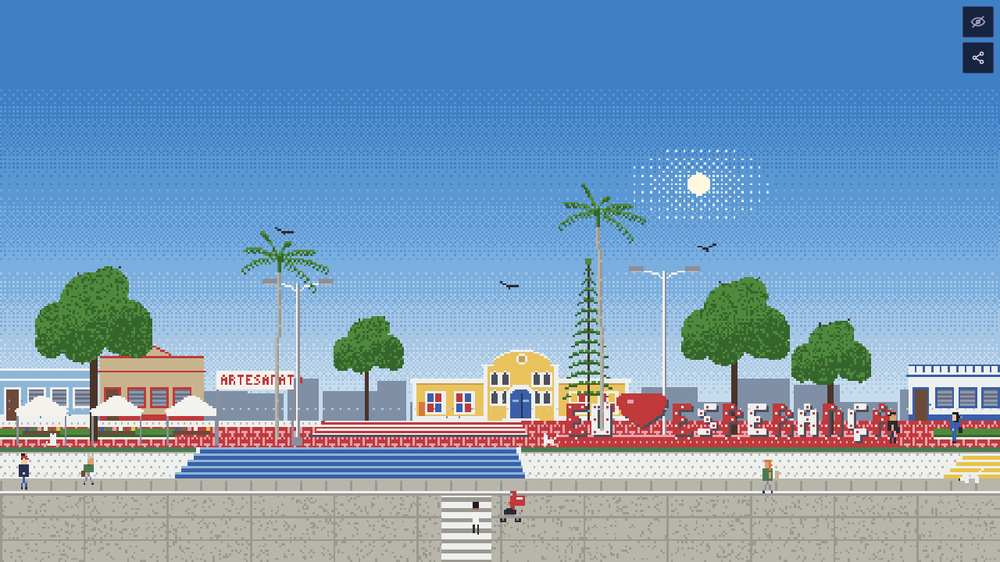
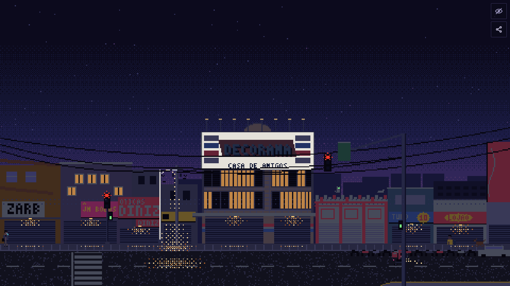

# LoFi City

Cenas lo-fi em pixel art de cidades da Paraíba (Esperança, Campina Grande, João Pessoa, Areia, Remígio) e de Tóquio que seguem o **horário real** e o **clima ao vivo** de cada lugar: se está chovendo lá, chove na tela; se é noite lá, é noite aqui. Tem gente, bichos e trânsito que dá para tocar, sinos da matriz, jogos no Campo da Rodoviária e duas rádios com música real em Creative Commons.

**Ao vivo:** https://loficity-lac.vercel.app

| Praça da Matriz, 10h | Praça da Cultura, 15h | Centro · Casa de Amigos, 18h30 |
| --- | --- | --- |
|  |  |  |

<sub>Capturas reais do app (`scripts/shot.mjs`, com `#at=` e `#wx=clear` de teste e o painel oculto).</sub>

## Como é feito

- Tudo é desenhado em código num framebuffer indexado com paleta, graduada para dia, pôr do sol, noite e nublado. Nenhuma imagem ou sprite.
- O clima vem só da API [Open-Meteo](https://open-meteo.com/), sem chave. Nunca é inventado: sem leitura, a tela diz "clima indisponível".
- A rádio toca álbuns do [Internet Archive](https://archive.org/) sob licenças Creative Commons, com crédito e link de cada faixa.
- Botão de compartilhar: copia o link exato da cena (`#city=`, `#scene=`) ou baixa um card 1080x1920 para stories. Nada é postado: quem envia é você.
- Botão "i" (só nas cenas de Esperança): conta a história real do lugar da cena, com curiosidades e links para as fontes (blog História Esperancense, Prefeitura e outras). Nada é inventado: onde não achamos a história de uma rua, o texto diz isso.

**Ferramentas:** TypeScript, Vite (o build é um único `dist/index.html`), pnpm, Open-Meteo, Internet Archive e Claude Code, com a skill [`create-scenario`](.claude/skills/create-scenario) para criar cenários a partir de fotos de referência.

## Rodar

```bash
pnpm install
pnpm dev         # http://localhost:5173
pnpm typecheck   # tsc --noEmit
pnpm test        # testes unitários (node --test, Node >= 22.18)
pnpm build       # dist/index.html
pnpm shot        # capturas em ./shots (precisa de build)
```

Cidades, cenários, opções de URL (`#city=`, `#scene=`, `#at=`, `#wx=`, `#debug`), atalhos de teclado e a organização do código estão em [docs/DEVELOPING.md](docs/DEVELOPING.md). Regras para agentes em [AGENTS.md](AGENTS.md); como contribuir em [CONTRIBUTING.md](CONTRIBUTING.md).

## Créditos e licença

- Código sob a licença [MIT](LICENSE).
- Clima: [Open-Meteo](https://open-meteo.com/) (CC BY 4.0).
- Mapa: contorno da Paraíba do [IBGE](https://www.ibge.gov.br/geociencias/organizacao-do-territorio/malhas-territoriais.html) (Malhas territoriais, simplificado), desenhado em código.
- Música: transmitida do [Internet Archive](https://archive.org/), de selos como [Dusted Wax Kingdom](https://archive.org/details/dustedwaxkingdom), sob licenças Creative Commons (a lista completa está em [docs/DEVELOPING.md](docs/DEVELOPING.md#credits) e em `src/audio/radio.ts`). A música **não** faz parte deste repositório nem da licença MIT, e as licenças NC proíbem uso comercial.
- O site usa [Vercel Web Analytics](https://vercel.com/docs/analytics) e [Speed Insights](https://vercel.com/docs/speed-insights), sem cookies.
